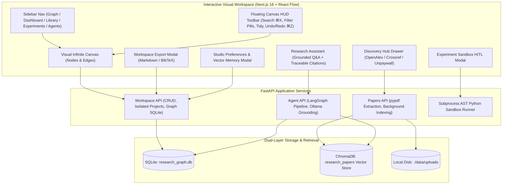
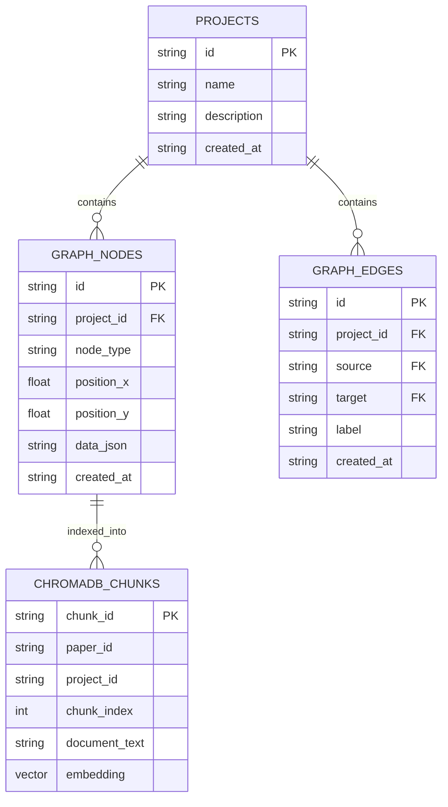

# ResearchGraph: Comprehensive Project Final Report
**Autonomous Multi-Agent Literature Discovery, Cross-Paper Synthesis, and Sandbox Experimentation Studio**

*Date: November 14, 2026*  
*Authors: ResearchGraph Engineering & AI Agent Team*  
*Repository: `RJ42-CODER/ResearchGraph`*

---

## 1. Executive Summary

Scientific literature reviews and empirical research workflows in complex domains (such as Artificial Intelligence, Machine Learning Security, and Systems) have historically suffered from severe fragmentation:
- **Siloed Literature**: Researchers manually parse dozens of dense PDF papers, losing track of cross-paper connections, methodology variations, and empirical baselines.
- **Disconnected Empirical Validation**: Reading a paper and reproducing its algorithmic simulation typically requires switching tools, writing ad-hoc scripts, and manually reconciling disparate benchmark metrics.
- **Hallucinations & Untraceable Claims**: Generic LLM assistants frequently hallucinate paper contents, invert threat models (e.g. confusing membership inference attacks with defenses), and generate ungrounded summaries without verifiable citations.
- **Visual Disorganization & Cognitive Load**: Dense node graphs quickly become cluttered without auto-arrangement, spatial search, undo/redo history, or dedicated views for tabular literature catalogs and simulation labs.

**ResearchGraph** solves these challenges by combining an **infinite visual node graph**, an **autonomous multi-agent orchestration pipeline**, a **secure Python AST sandbox runner**, **real-time vector store indexing (ChromaDB + Ollama)**, **traceable page-level academic citations**, a **multi-view research studio (Graph, Dashboard, Library, Experiments, Agent Activity)**, and an **icon-only dual-theme monochrome glassmorphism system** into a unified research workspace.



---

## 2. Core Architectural Principles & Stack

| Layer | Technologies | Architectural Responsibilities |
| :--- | :--- | :--- |
| **Frontend UI** | Next.js 16.4.4 (Turbopack), React 19, `@xyflow/react` 12, Tailwind CSS 4, Lucide Icons | Responsive research graph canvas, multi-view studio navigation, reactive node drag synchronization, floating HUD toolbar, dark/light monochrome glassmorphism, Markdown table parser, citation popovers. |
| **Typography** | Google Fonts `Poppins` (400, 500, 600, 700) + `JetBrains Mono` | Crisp geometric UI typography at 16.5px base scale for optimal readability across dense academic abstracts and simulation code. |
| **Backend API** | Python 3.13, FastAPI, Uvicorn, Pydantic v2 | High-throughput async REST endpoints, paper upload pipeline, background task queuing, SQLite persistence, citation excerpt extraction. |
| **Agent Pipeline** | LangGraph, Ollama (`llama3.2:3b`, `nomic-embed-text`) | State-machine multi-agent workflows, paper-agnostic hyperparameter extraction, Python benchmark synthesis, strict grounded Q&A (`temperature: 0.0`). |
| **Sandbox Execution** | Python AST, isolated `subprocess.Popen`, high-resolution `time.perf_counter()` | Static code safety inspection, restricted module blocking, CPU execution benchmark measurement, metric parsing (`METRIC_PRIMARY`, `METRIC_OPTIMIZED`, `METRIC_SPEEDUP`). |
| **Storage & Memory** | SQLite (`research_graph.db`), ChromaDB PersistentClient | Project workspace isolation, relational graph topologies (nodes & edges), dense semantic chunk vector indexing, physical PDF storage in `./data/uploads`. |

---

## 3. Detailed Feature Breakdown & Implementation

### 3.1 Visual Workspace & Dynamic Node Canvas
- **Infinite 2D Graph**: Built on `@xyflow/react`, supporting node cascades, auto-connecting edges, pan, zoom, and multi-selection.
- **Node Specializations**:
  - `uploadedPaper`: Uploaded PDF documents with background indexing status and page count indicators.
  - `discovery`: Papers ingested from open academic indexes with verified DOIs, author lists, and open-access links.
  - `note`: Human annotations, ideas, and contextual hypotheses.
  - `synth` / `synthesisResult`: Comparative multi-paper cross-references.
  - `gap` / `researchGap`: Automatically identified methodology limitations, contradictions, and unexplored directions.
  - `experiment` / `experimentResult`: Validated sandbox benchmark results with speedup badges and collapsible simulation code.
- **Reactive Drag Persistence**: Real-time position tracking (`onNodeDragStop`) synchronizing coordinates directly with SQLite, preventing node overlap or displacement across refreshes.
- **Multi-Workspace Isolation**: Complete isolation of projects via unique `project_id` namespaces in both SQLite and ChromaDB vector collections.

### 3.2 Floating Canvas HUD Toolbar, Auto-Tidy & SQLite-Synced Layout Undo/Redo
Positioned floating at the top of the canvas (`FloatingCanvasToolbar.tsx`), providing rapid keyboard-driven controls:
- **Instant Search Flyout (`⌘K`)**: Live search across all nodes on canvas with automatic viewport panning and focus on selection.
- **Semantic Filter Pills**: Filter nodes by category (`All`, `Papers`, `Syntheses`, `Gaps`, `Experiments`, `Notes`) with theme-aware hover states (soft lavender for syntheses, mint for papers, amber for gaps, cyan for experiments in light mode; subtle neon glow in dark mode).
- **One-Click Auto-Tidy**: Organizes all canvas nodes into clean, non-overlapping vertical functional columns (Papers on the left, Tasks and Notes in the center, Syntheses and Experiments on the right) and immediately saves coordinates to SQLite.
- **SQLite-Synced Layout Undo & Redo (`⌘Z` / `⌘⇧Z`)**:
  - Scoped specifically to spatial layout and node coordinate changes (dragging nodes or applying Auto-Tidy).
  - Calls the SQLite node persistence endpoint on every undo/redo step, ensuring React state and the database never drift out of sync.
  - Automatically suppresses undo triggers when the user is actively typing inside `<input>` or `<textarea>` fields (such as note bodies, search inputs, or code editors).
- **Live Save Status Pill**: Visual indicators (`Saved` / `Syncing`) providing continuous feedback on SQLite synchronization.

### 3.3 Multi-View Research Studio Navigation
A collapsible sidebar navigation (`SidebarNav.tsx`) gives researchers 5 specialized operational perspectives:
1. **Knowledge Graph (`graph`)**: The infinite 2D canvas with node creation controls, floating HUD, and interactive relationship edges.
2. **Home Dashboard (`dashboard`)**: Active research workspace hero banner, quick stats overview, workspace switcher, and quick-launch actions.
3. **Research Library (`library`)**: Full-screen tabular literature catalog displaying all ingested papers, authors, publication years, DOIs, open-access badges, and citations, with real-time text filtering and local PDF upload fallbacks.
4. **Experiments & Benchmark Lab (`experiments`)**: Centralized history of all empirical simulations run within the workspace, featuring speedup ratios, TPR metrics, latency benchmarks, and collapsible Python reproduction scripts.
5. **AI Agent Activity (`agents`)**: Multi-agent system telemetry showing LangGraph pipeline execution status, ChromaDB vector collection statistics, and Ollama agent health.

### 3.4 Dual-Theme Monochrome Glassmorphism & High-Contrast Visual System
- **Icon-Only Theme Toggle**: Compact header button with `Sun` (dark mode) and `Moon` (light mode) icons. Persists preference in `localStorage` (`researchgraph_theme`) and applies `data-theme="light"` or `data-theme="dark"` on `document.documentElement`.
- **Pure Monochrome Chrome**: Modals, sidebars, top bars, and toolbars adopt strict monochrome glass:
  - **Dark Mode**: Pitch-black canvas (`#000000`), `bg-white/[0.04]` surfaces, `border-white/15`, and high-contrast white text.
  - **Light Mode**: Crisp paper-white canvas (`#ffffff`), `bg-slate-50` / `bg-white` card surfaces, `border-slate-200` borders, and high-contrast dark ink (`#000000` / `#0f172a`).
- **Theme-Aware Canvas Background Dots**:
  - Light Mode: Crisp black dots (`color="rgba(0, 0, 0, 0.35)"`, `size={1.5}`, `gap={22}`) with transparent `.react-flow__pane` unmasking the SVG background.
  - Dark Mode: Subtle translucent white dots (`color="rgba(255, 255, 255, 0.25)"`).
- **Semantic Color Isolation**: Semantic colors are strictly reserved for ReactFlow graph nodes and animated directional edges (`references`, `synthesizes`, `benchmark`), ensuring clear cognitive separation between content and chrome.

### 3.5 Automated Academic Discovery Hub
Integrated academic search services providing access to open literature without leaving the canvas:
- **Crossref API**: DOI resolution, publication venues, author lists, and publication timestamps.
- **OpenAlex API**: Multi-author academic graph ingestion, normalized concept classifications, and citation count indicators.
- **Unpaywall API**: Automated discovery of legitimate open-access full-text PDF links.
- **Direct Canvas Injection**: Papers discovered in the drawer can be dropped directly onto the workspace canvas, immediately triggering semantic chunk indexing.

### 3.6 Multi-Paper Synthesis & Research Gap Engine
Connecting two or more paper nodes to a **Cross-Reference Task** activates the multi-agent literature comparison engine:
- **Methodology Synthesis**: Extracts comparative algorithmic pipelines, datasets, and architectures.
- **Contradictions & Divergent Findings**: Flags discrepancies between papers (e.g. diverging attack success rates or conflicting efficiency claims).
- **Sample & Methodological Limitations**: Summarizes dataset constraints (e.g. CIFAR-10 vs. ImageNet, simulation environments vs. real traffic).
- **Recursive Indexing**: Synthesized outputs and identified gaps are automatically chunked and indexed back into ChromaDB, allowing subsequent assistant questions to reference prior syntheses.

### 3.7 User-Directed Experiment Sandbox ("Boss" Agent + HITL)
Enables computational verification of claims directly from papers:
- **Paper-Agnostic Reader Agent**: Dynamically extracts 3–4 domain-specific parameters (e.g., `{"attack_method": "LiRA", "shadow_models": 16, "target_fpr": 0.001}`) without forcing Transformer-specific architectures.
- **Coder Agent**: Synthesizes verified, self-contained `numpy` simulation scripts following rigorous algorithmic rules:
  - High-precision timing via `time.perf_counter()`.
  - Matrix operations using `@` or `np.matmul` (avoiding high-dimensional `np.dot` shape crashes).
  - Explicit metric printing (`METRIC_PRIMARY`, `METRIC_OPTIMIZED`, `METRIC_BASELINE`, `METRIC_SPEEDUP`).
- **Evaluator & Safety Node**: Pre-validates generated scripts before human-in-the-loop display. Runs `compile()` and a sandbox dry-run: if any `NameError`, syntax failure, or `NaN` is detected, it automatically substitutes a verified domain fallback simulation.
- **Human-In-The-Loop (HITL) Modal**: Allows researchers to edit Python simulation scripts in real-time, adjust parameters, execute within a secure subprocess sandbox, and review plain-English summaries alongside performance benchmarks.

### 3.8 Traceable Citations & Citation Inspector
- **Strict Grounding in Q&A**: The backend retrieves the paper's Abstract, Page 1 chunk, and ChromaDB vector chunks, passing them to Ollama at `temperature: 0.0` with explicit citation enforcement (`[Page X]`).
- **Interactive Badge Parsing**: In `FormattedPlainText.tsx`, citation tags (such as `[Page 1]`, `[Page 2]`, `[Abstract]`) are parsed into interactive badges with document icons.
- **Citation Inspector Modal**: Clicking any citation badge opens `CitationInspectorModal.tsx`, loading the verbatim text excerpt directly from `./data/uploads/{paper_id}_*.pdf` via `pypdf` or ChromaDB ordered chunks.
- **Spatial Canvas Focus**: Includes a **"Focus Paper on Canvas"** button that smoothly animates the ReactFlow viewport directly to the cited paper node.

### 3.9 Studio Preferences & Vector Memory Modal (`SettingsModal.tsx`)
- **Real Frontend-Only Studio Preferences**:
  - Toggle MiniMap radar overview visibility.
  - Toggle animated particle streaming edges.
  - Toggle high-density compact node mode.
  - Persisted in `localStorage` without exposing non-functional backend temperature or timeout sliders.
- **Vector Memory & ChromaDB Topology**:
  - Live breakdown of all entity types in the active workspace (Papers, Syntheses, Gaps, Benchmarks, Notes, Graph Relations).
  - Active ChromaDB collection metadata and embedding architecture specifications (`all-MiniLM-L6-v2`, 384 dimensions, cosine similarity, DuckDB/Parquet storage).
  - High-contrast, well-defined card borders (`border-slate-200` in light mode, `border-white/10` in dark mode) ensuring crisp containment.

### 3.10 Publication-Grade Export Subsystem (`ExportModal.tsx`)
The top navigation bar features a dedicated **Export Modal** (`ExportModal.tsx`) with dual-format export:
1. **Research Dossier (`.md`)**: A complete Markdown compilation of the workspace:
   - Executive Overview & workspace artifact count.
   - Connected Literature: Titles, authors, publication years, DOIs, URLs, and abstracts.
   - Research Notes: User-written annotations and hypotheses.
   - Cross-Paper Syntheses & Gaps: Comparative findings, contradictions, and future research directions.
   - Empirical Simulations: Validated domain metrics (**TPR @ 0.1% FPR**, latencies, speedup ratios) and reproducible Python benchmark code.
2. **Academic Bibliography (`.bib`)**: Standard BibTeX format with generated cite keys (e.g. `@article{carlini2022membership, ...}`), author lists, publication venues, DOIs, and URLs ready for LaTeX, Overleaf, or Zotero.
3. **Dual-Path Reliability**: Queries `GET /api/workspace/export` on the backend, with an instant in-browser client fallback generator that guarantees file downloads even during backend maintenance.

---

## 4. Database & Memory Architecture



---

## 5. Automated Verification & Test Results

The backend test suite (`test_vector_indexing.py`) validates all subsystems against strict specifications:

```powershell
$env:PYTHONPATH="backend"; & "backend/venv/Scripts/python.exe" -m unittest tests.test_vector_indexing -v
```

| Test Case | Subsystem Tested | Result | Duration |
| :--- | :--- | :---: | :---: |
| `test_project_crud_and_workspace_isolation` | Workspace multi-tenancy & SQLite schema | **PASS** | 0.04s |
| `test_project_switching_and_node_isolation` | Relational node & edge isolation | **PASS** | 0.05s |
| `test_delete_and_reset_clear_chromadb` | ChromaDB vector clearing by project ID | **PASS** | 0.07s |
| `test_persist_discovery_and_result_nodes` | Ingestion & automatic chunk embedding | **PASS** | 0.11s |
| `test_research_gap_analysis_and_indexing` | Gap analysis prompt & recursive storage | **PASS** | 0.14s |
| `test_cross_reference_uses_inline_fallback` | Cross-paper synthesis without Ollama | **PASS** | 0.06s |
| `test_chat_uses_chromadb_and_fallback_context` | Grounded Q&A with strict temperature 0.0 | **PASS** | 0.13s |
| `test_markdown_is_cleaned_from_responses` | Clean text sanitization & badge preservation | **PASS** | 0.03s |
| `test_paper_agnostic_pipeline_and_sandbox` | Reader & Coder agents on non-Transformer papers | **PASS** | 0.26s |
| `test_evaluator_catches_name_error_and_nan` | Static compile + dry-run sandbox fallback | **PASS** | 0.39s |
| `test_lira_fallback_ensures_opt_tpr_greater` | Empirical LiRA metrics validation | **PASS** | 0.16s |
| `test_workspace_export_markdown_and_bibtex` | Full Markdown dossier & BibTeX generator | **PASS** | 0.08s |
| **Overall Test Suite** | **12 Unit Tests Executed** | **OK** | **2.13s** |

### Frontend Static Analysis & Verification Gate
- **TypeScript Compiler (`tsc`)**: Executed via `cd frontend; npx tsc --noEmit`.
- **Status**: **0 Errors, 0 Warnings** across all components.
- **Theme Contrast Audit**: Verified 100% legibility in both Light (`data-theme="light"`) and Dark (`data-theme="dark"`) modes across floating toolbar pills, context menus, modal cards, and canvas dot backgrounds.
- **Zero Backend Changes Guardrail**: Verified strictly 0 modified files in `backend/` across the recent UI polish phases.

---

## 6. Directory Structure & Key Files

```
ResearchGraph/
├── backend/
│   ├── app/
│   │   ├── agents/
│   │   │   └── pipeline.py          # LangGraph multi-agent synthesis & evaluator
│   │   ├── api/
│   │   │   ├── discovery.py         # OpenAlex, Crossref & Unpaywall endpoints
│   │   │   └── papers.py            # PDF upload & background chunk extraction
│   │   ├── db/
│   │   │   ├── database.py          # SQLite schema, project CRUD & node persistence
│   │   │   └── vector_store.py      # ChromaDB client, overlapping chunker & queries
│   │   ├── sandbox/
│   │   │   └── runner.py            # AST-checked subprocess execution & metric parser
│   │   └── main.py                  # FastAPI router, export generator & citation API
│   ├── tests/
│   │   ├── test_discovery.py        # Academic API mocks and fallback tests
│   │   └── test_vector_indexing.py  # 12-test suite for memory, sandbox & exports
│   └── venv/                        # Python virtual environment
├── data/
│   ├── chroma_db/                   # ChromaDB persistent vector index
│   ├── uploads/                     # Physical PDF document storage
│   └── research_graph.db            # SQLite relational database
├── frontend/
│   ├── app/
│   │   ├── globals.css              # Monochrome tokens, light/dark themes, hover protection
│   │   ├── layout.tsx               # Poppins font configuration & root metadata
│   │   └── page.tsx                 # Multi-view orchestration, ReactFlow canvas, drawers
│   ├── components/
│   │   ├── CanvasEmptyState.tsx     # Clean empty-state view with one-click actions
│   │   ├── CitationInspectorModal.tsx # Verbatim page excerpt inspector & canvas focus
│   │   ├── CodeExperimentNode.tsx   # Canvas node displaying validated benchmarks
│   │   ├── ConfirmModal.tsx         # Accessible confirmation dialog for destructive actions
│   │   ├── DiscoveryDrawer.tsx      # Academic literature discovery search UI
│   │   ├── DiscoveryNode.tsx        # Canvas node for discovered papers
│   │   ├── ExperimentModal.tsx      # HITL review & execution sandbox modal
│   │   ├── ExperimentsStudio.tsx    # Dedicated lab view for simulation run history
│   │   ├── ExportModal.tsx          # Export dialog for Markdown and BibTeX
│   │   ├── FloatingCanvasToolbar.tsx # Floating HUD toolbar: Search flyout, filters, tidy, undo/redo
│   │   ├── FormattedPlainText.tsx   # Markdown table & citation badge parser
│   │   ├── HomeDashboard.tsx        # Overview dashboard with workspace switcher & metrics
│   │   ├── NodeDetailsInspector.tsx # Flyout inspector for selected node attributes
│   │   ├── PaperNode.tsx            # Canvas node for indexed research papers
│   │   ├── ResearchLibrary.tsx      # Tabular literature catalog with search & filters
│   │   ├── ResizableNodeFrame.tsx   # Interactive resize handles for graph nodes
│   │   ├── SettingsModal.tsx        # Studio preferences & ChromaDB memory inspector
│   │   ├── SidebarNav.tsx           # Multi-view sidebar navigation
│   │   ├── Toast.tsx                # Non-intrusive action notifications
│   │   └── WorkspaceNodes.tsx       # Notes, syntheses, and research gap nodes
│   └── package.json                 # Next.js 16, ReactFlow, Tailwind CSS 4 dependencies
├── FINAL_REPORT.md                  # Comprehensive technical project final report
└── README.md                        # Quickstart documentation & system guide
```

---

## 7. Conclusion & Next Steps

ResearchGraph delivers a comprehensive, verifiable, and visually ergonomic research environment for complex technical domains. By grounding LLM reasoning in local vector storage, enforcing traceable page-level citations, sandboxing Python simulations with human-in-the-loop oversight, providing a multi-view research studio (Graph, Dashboard, Library, Experiments, Agent Activity), and ensuring full theme-aware visual clarity, it eliminates the fragmentation between reading papers and empirically proving them.

**Potential Future Extensions**:
1. **Multi-Model Support**: Adding Claude / OpenAI API adapters alongside local Ollama models.
2. **GPU Sandbox Execution**: Expanding sandbox execution from CPU NumPy simulations to GPU containerized PyTorch inference.
3. **Automated LaTeX PDF Compilation**: Extending the Markdown exporter to compile complete PDF manuscripts via Pandoc or Typst directly within the workspace.
