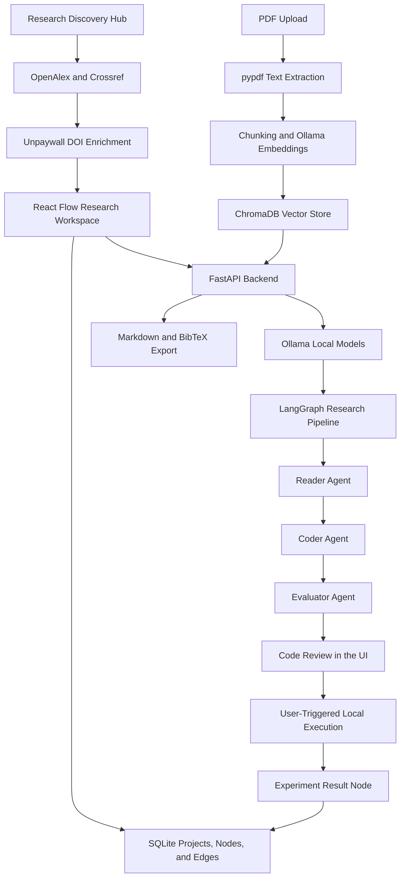

# ResearchGraph 🔬⚡

**Autonomous Multi-Agent Literature Discovery, Cross-Paper Synthesis, and Sandbox Experimentation Studio**

ResearchGraph is an interactive, AI-orchestrated research workspace built with **Next.js 16 (React Flow)**, **FastAPI**, **LangGraph**, **Ollama**, **ChromaDB**, and **SQLite**.

ResearchGraph bridges the divide between reading machine learning research papers, discovering verified scientific literature, and practically validating findings. Researchers can visually ingest academic PDFs or search global literature databases, extract domain parameters through local semantic vector memory, synthesize reproducible benchmark scripts, and execute them with Human-in-the-Loop (HITL) verification within an isolated Python sandbox.

---

## Contents

- [Core Capabilities](#core-capabilities)
- [Multi-View Research Studio](#multi-view-research-studio)
- [Floating Canvas HUD Toolbar](#floating-canvas-hud-toolbar)
- [Research Workflow](#research-workflow)
- [System Architecture](#system-architecture)
- [Technology Stack](#technology-stack)
- [Repository Structure](#repository-structure)
- [Prerequisites](#prerequisites)
- [Local Installation](#local-installation)
- [Environment Configuration](#environment-configuration)
- [Running the Application](#running-the-application)
- [Testing and Quality Checks](#testing-and-quality-checks)
- [Data Storage](#data-storage)
- [API Overview](#api-overview)
- [Security and Current Limitations](#security-and-current-limitations)
- [Troubleshooting](#troubleshooting)
- [License](#license)

---

## Core Capabilities

### 1. Academic Research Discovery
The Research Discovery Hub provides academic search and metadata enrichment within the workspace.
- **OpenAlex** is the primary scholarly search provider.
- **Crossref** supplies bibliographic metadata and DOI-based lookup.
- **Unpaywall** resolves open-access availability for individual DOI records.
- Search results are normalised and deduplicated using DOI and title matching.
- Available abstracts, authors, publication details, DOI values, and open-access links are displayed in the interface.
- Discovered papers can be injected directly onto the research canvas with automatic vector chunking.

### 2. Visual Research Workspace & Infinite Canvas
The application uses a responsive React Flow canvas to organise research artefacts as connected nodes:
- Add discovered papers, uploaded PDFs, notes, synthesis results, research-gap results, and experiment outputs.
- Arrange and connect nodes on an interactive canvas with animated directional streaming edges (`references`, `synthesizes`, `benchmark`).
- Create multiple independent research workspaces with strict project namespace isolation.
- Persist node coordinates, node data, relationships, and project information in SQLite.

### 3. PDF Ingestion and Semantic Retrieval
- Upload PDF research papers through the canvas.
- Extract text from PDF pages with `pypdf` in background tasks.
- Split extracted text into overlapping chunks.
- Store vector embeddings in ChromaDB using Ollama's `nomic-embed-text` model.
- Retrieve content using paper-specific metadata filters to avoid mixing chunks from unrelated papers.

### 4. AI-Assisted Paper Analysis & Traceable Citations
- Strict Grounding in Q&A: Retrieves abstract, Page 1, and ChromaDB vector chunks, passing them to Ollama at `temperature: 0.0`.
- Interactive Citation Badges: Grounded citations (`[Page X]`, `[Abstract]`) are interactive badges in assistant chat responses.
- Citation Inspector Modal: Clicking any badge opens `CitationInspectorModal.tsx`, displaying verbatim text excerpts from `./data/uploads/{paper_id}_*.pdf` with a **"Focus Paper on Canvas"** button.
- Cross-Paper Synthesis & Gaps: Compares methodology pipelines, contradictions, and unexplored research gaps.

### 5. Experiment Code Generation and Execution (Boss Agent + HITL)
- **Reader Agent:** Dynamically extracts domain-specific parameters without forcing Transformer-specific architectures.
- **Coder Agent:** Synthesizes verified, self-contained `numpy` simulation scripts with high-precision timing via `time.perf_counter()`.
- **Evaluator Agent:** Pre-validates generated scripts using static compile checks and dry-run sandboxing, substituting verified domain fallbacks if errors occur.
- **Human-in-the-Loop (HITL) Modal:** Inspect, adjust parameters, edit code in real-time, execute within a secure subprocess sandbox, and review plain-English summaries alongside performance benchmarks.

### 6. Dual-Path Research Export
Each workspace can be exported in two formats:
- **Markdown Research Dossier (`.md`):** Complete compilation of project metadata, connected literature, notes, syntheses, gaps, and empirical benchmark code.
- **Academic Bibliography (`.bib`):** BibTeX citation entries generated from paper metadata ready for LaTeX, Overleaf, or Zotero.
- **Dual-Path Reliability:** Server-side API export with an instant in-browser client fallback generator.

---

## Multi-View Research Studio

A collapsible sidebar navigation (`SidebarNav.tsx`) gives researchers 5 specialized operational perspectives:

1. **Knowledge Graph (`graph`):** The infinite 2D canvas with node creation controls, floating HUD, and interactive relationship edges.
2. **Home Dashboard (`dashboard`):** Active research workspace hero banner, quick stats overview, workspace switcher, and quick-launch actions.
3. **Research Library (`library`):** Full-screen tabular literature catalog displaying all ingested papers, authors, publication years, DOIs, open-access badges, and citations, with real-time text filtering and local PDF upload fallbacks.
4. **Experiments & Benchmark Lab (`experiments`):** Centralized history of all empirical simulations run within the workspace, featuring speedup ratios, TPR metrics, latency benchmarks, and collapsible Python reproduction scripts.
5. **AI Agent Activity (`agents`):** Multi-agent system telemetry showing LangGraph pipeline execution status, ChromaDB vector collection statistics, and Ollama agent health.

---

## Floating Canvas HUD Toolbar

Positioned floating at the top of the canvas (`FloatingCanvasToolbar.tsx`), providing rapid keyboard-driven controls:

- **Instant Search Flyout (`⌘K`):** Live search across all nodes on canvas with automatic viewport panning and focus on selection.
- **Semantic Filter Pills:** Filter nodes by category (`All`, `Papers`, `Syntheses`, `Gaps`, `Experiments`, `Notes`) with theme-aware hover states.
- **One-Click Auto-Tidy:** Organizes all canvas nodes into clean, non-overlapping vertical functional columns and immediately saves coordinates to SQLite.
- **SQLite-Synced Layout Undo & Redo (`⌘Z` / `⌘⇧Z`):** Tracks spatial layout changes, persisting coordinates to SQLite on every step while safely ignoring keystrokes when typing in text fields.
- **Live Save Status Pill:** Visual indicators (`Saved` / `Syncing`) providing continuous feedback on SQLite synchronization.

---

## Dual-Theme Monochrome Glassmorphism

- **Icon-Only Theme Toggle:** Compact header button with `Sun` (dark mode) and `Moon` (light mode) icons. Persists preference in `localStorage` (`researchgraph_theme`) and applies `data-theme="light"` or `data-theme="dark"` on `document.documentElement`.
- **Pure Monochrome Chrome:** Modals, sidebars, top bars, and toolbars adopt strict monochrome glass:
  - **Dark Mode:** Deep black canvas (`#000000`), `bg-white/[0.04]` surfaces, `border-white/15`, and subtle white grid dots.
  - **Light Mode:** Crisp paper-white canvas (`#ffffff`), `bg-slate-50` card surfaces, `border-slate-200` borders, and crisp black grid dots (`fill: #000000; opacity: 0.35`).
- **Semantic Color Isolation:** Semantic colors are strictly reserved for ReactFlow graph nodes and animated directional edges, ensuring clear cognitive separation between content and chrome.

---

## Research Workflow

A typical workflow in ResearchGraph is:

1. Create or select a research workspace from the Home Dashboard or header switcher.
2. Search for literature in the Research Discovery Hub or drag-and-drop local PDF papers onto the canvas.
3. Automatically index paper content into ChromaDB with local embeddings.
4. Ask grounded questions with page-level citations or connect papers to a Cross-Reference Task to discover research gaps.
5. Trigger the Experiment Agent to extract domain parameters and synthesize benchmark code.
6. Inspect, edit, and run the Python simulation script with Human-in-the-Loop oversight.
7. Review benchmark metrics in the canvas node or the Experiments Lab.
8. Export the complete workspace as a Markdown Research Dossier or BibTeX bibliography.

---

## System Architecture



### Data and Processing Responsibilities

| Layer | Responsibility |
| :--- | :--- |
| **Next.js Frontend** | Multi-view research studio, React Flow canvas, discovery drawer, contextual assistant, experiment modals |
| **Floating HUD** | Quick search flyout (`⌘K`), node type filtering, auto-tidy layout, SQLite-synced undo/redo (`⌘Z`) |
| **FastAPI Backend** | REST API endpoints, PDF extraction tasks, workspace graph persistence, citation excerpt service |
| **LangGraph** | Multi-agent Reader, Coder, and Evaluator pipeline orchestration |
| **Ollama** | Local LLM inference (`llama3.2:3b`) and text embeddings (`nomic-embed-text`) |
| **ChromaDB** | Semantic vector storage and paper-specific retrieval |
| **SQLite** | Relational persistence for projects, nodes, edges, and coordinates |
| **Academic APIs** | Scholarly search, DOI metadata enrichment and open-access resolution |

---

## Technology Stack

| Area | Technologies |
| :--- | :--- |
| **Frontend** | Next.js 16.4.4 (Turbopack), React 19, TypeScript, Tailwind CSS 4 |
| **Visualisation** | React Flow (`@xyflow/react` 12) |
| **Typography** | Google Fonts `Poppins` (UI/Headings) + `JetBrains Mono` (Code/Metrics) |
| **Backend** | Python 3.13, FastAPI, Uvicorn, Pydantic v2 |
| **Agent Orchestration** | LangGraph, LangChain, Ollama integration |
| **Local LLM & Embeddings** | Ollama with `llama3.2:3b` and `nomic-embed-text` |
| **Vector Storage** | ChromaDB PersistentClient |
| **Relational Storage** | SQLite (`research_graph.db`) |
| **PDF Extraction** | pypdf |

---

## Repository Structure

```
ResearchGraph/
├── backend/
│   ├── app/
│   │   ├── agents/
│   │   │   └── pipeline.py          # LangGraph multi-agent synthesis & evaluator
│   │   ├── api/
│   │   │   ├── discovery.py         # OpenAlex, Crossref & Unpaywall endpoints
│   │   │   └── papers.py            # PDF upload & background chunk extraction
│   │   ├── core/
│   │   │   └── config.py            # Pydantic environment configuration
│   │   ├── db/
│   │   │   ├── database.py          # SQLite schema, project CRUD & node persistence
│   │   │   └── vector_store.py      # ChromaDB client, overlapping chunker & queries
│   │   ├── sandbox/
│   │   │   └── runner.py            # AST-checked subprocess execution & metric parser
│   │   └── main.py                  # FastAPI router, export generator & citation API
│   ├── tests/
│   │   ├── test_discovery.py        # Academic API mocks and fallback tests
│   │   └── test_vector_indexing.py  # 12-test suite for memory, sandbox & exports
│   ├── .env.example                 # Example backend environment variables
│   └── requirements.txt             # Pinned backend dependencies
├── data/
│   ├── chroma_db/                   # ChromaDB persistent vector index
│   ├── uploads/                     # Physical PDF document storage
│   └── research_graph.db            # SQLite relational database
├── frontend/
│   ├── app/
│   │   ├── globals.css              # Monochrome tokens, light/dark themes, hover protection
│   │   ├── layout.tsx               # Poppins font configuration & root metadata
│   │   └── page.tsx                 # Multi-view orchestration, ReactFlow canvas, drawers
│   ├── components/
│   │   ├── CanvasEmptyState.tsx     # Clean empty-state view with one-click actions
│   │   ├── CitationInspectorModal.tsx # Verbatim page excerpt inspector & canvas focus
│   │   ├── CodeExperimentNode.tsx   # Canvas node displaying validated benchmarks
│   │   ├── ConfirmModal.tsx         # Accessible confirmation dialog for destructive actions
│   │   ├── DiscoveryDrawer.tsx      # Academic literature discovery search UI
│   │   ├── DiscoveryNode.tsx        # Canvas node for discovered papers
│   │   ├── ExperimentModal.tsx      # HITL review & execution sandbox modal
│   │   ├── ExperimentsStudio.tsx    # Dedicated lab view for simulation run history
│   │   ├── ExportModal.tsx          # Export dialog for Markdown and BibTeX
│   │   ├── FloatingCanvasToolbar.tsx # Floating HUD toolbar: Search flyout, filters, tidy, undo/redo
│   │   ├── FormattedPlainText.tsx   # Markdown table & citation badge parser
│   │   ├── HomeDashboard.tsx        # Overview dashboard with workspace switcher & metrics
│   │   ├── NodeDetailsInspector.tsx # Flyout inspector for selected node attributes
│   │   ├── PaperNode.tsx            # Canvas node for indexed research papers
│   │   ├── ResearchLibrary.tsx      # Tabular literature catalog with search & filters
│   │   ├── ResizableNodeFrame.tsx   # Interactive resize handles for graph nodes
│   │   ├── SettingsModal.tsx        # Studio preferences & ChromaDB memory inspector
│   │   ├── SidebarNav.tsx           # Multi-view sidebar navigation
│   │   ├── Toast.tsx                # Non-intrusive action notifications
│   │   └── WorkspaceNodes.tsx       # Notes, syntheses, and research gap nodes
│   └── package.json                 # Next.js 16, ReactFlow, Tailwind CSS 4 dependencies
├── FINAL_REPORT.md                  # Comprehensive technical project final report
└── README.md                        # Quickstart documentation & system guide
```

---

## Prerequisites

- **Python 3.11+** (Tested on Python 3.13)
- **Node.js 20+** (Tested on Node.js 22 LTS)
- **npm** (included with Node.js)
- **Git**
- **[Ollama](https://ollama.com/)** for local model inference and embeddings

A dedicated GPU is not mandatory. Model response time and embedding throughput depend on the host CPU, memory, and storage.

---

## Local Installation

### 1. Clone the Repository

```bash
git clone https://github.com/RJ42-CODER/ResearchGraph.git
cd ResearchGraph
```

### 2. Pull Local Ollama Models

Install and start Ollama, then pull the required models:

```bash
ollama pull llama3.2:3b
ollama pull nomic-embed-text
```

Verify that both models are ready:

```bash
ollama list
```

### 3. Set Up Backend

```bash
cd backend
python -m venv venv
```

Activate the virtual environment:
- **Windows (PowerShell):** `.\venv\Scripts\Activate.ps1`
- **Linux / macOS:** `source venv/bin/activate`

Install dependencies:

```bash
python -m pip install --upgrade pip
python -m pip install -r requirements.txt
```

Create configuration:
- **Windows (PowerShell):** `Copy-Item .env.example .env`
- **Linux / macOS:** `cp .env.example .env`

Edit `backend/.env` with your contact email for Crossref / Unpaywall polite pools.

### 4. Set Up Frontend

Open a second terminal in `frontend`:

```bash
cd frontend
npm install
```

---

## Environment Configuration

The backend loads settings from `backend/.env` through `python-dotenv`:

### Academic API Settings

| Variable | Purpose | Requirement |
| :--- | :--- | :--- |
| `OPENALEX_API_URL` | OpenAlex API base URL | Defaults to `https://api.openalex.org` |
| `OPENALEX_API_KEY` | Optional OpenAlex API key | Optional (keyless requests supported) |
| `CROSSREF_API_URL` | Crossref API base URL | Defaults to `https://api.crossref.org` |
| `CROSSREF_MAILTO` | Contact email for Crossref polite pool | Recommended |
| `UNPAYWALL_API_URL` | Unpaywall API base URL | Defaults to `https://api.unpaywall.org` |
| `UNPAYWALL_EMAIL` | Contact email for Unpaywall DOI lookup | Required for Unpaywall enrichment |

---

## Running the Application

### 1. Start Backend API Server

In `backend` (with venv activated):

```bash
uvicorn app.main:app --reload --port 8000
```

Interactive Swagger documentation is available at `http://localhost:8000/docs`.

### 2. Start Frontend Development Server

In `frontend`:

```bash
npm run dev
```

Open `http://localhost:3000` in your browser.

---

## Testing and Quality Checks

### Backend Unit Tests

Execute the comprehensive 12-test vector indexing, sandbox, and export test suite:

```powershell
$env:PYTHONPATH="backend"; & "backend/venv/Scripts/python.exe" -m unittest tests.test_vector_indexing -v
```

All 12 unit tests pass in ~2 seconds:
- `test_project_crud_and_workspace_isolation`
- `test_project_switching_and_node_isolation`
- `test_delete_and_reset_clear_chromadb`
- `test_persist_discovery_and_result_nodes_index_into_chromadb`
- `test_research_gap_analysis_and_indexing`
- `test_cross_reference_uses_inline_fallback_and_indexes_it`
- `test_chat_uses_chromadb_and_fallback_context_without_hallucinating`
- `test_markdown_is_cleaned_from_responses`
- `test_paper_agnostic_pipeline_and_sandbox_execution`
- `test_evaluator_catches_name_error_and_nan_and_substitutes_fallback`
- `test_lira_fallback_ensures_opt_tpr_greater_than_baseline_tpr`
- `test_workspace_export_markdown_and_bibtex_and_citations`

### Frontend Static Analysis

```bash
cd frontend
npx tsc --noEmit
```
Expected: `0 Errors, 0 Warnings`.

---

## Data Storage

- **SQLite Database (`data/research_graph.db`):** Stores project records, node attributes, canvas coordinates, and directional relationship edges.
- **ChromaDB Vector Index (`data/chroma_db/`):** Stores overlapping chunk embeddings isolated by `project_id` and `paper_id`.
- **Uploaded PDFs (`data/uploads/`):** Local document repository for text extraction and verbatim excerpt verification.

---

## 🔒 Security and Current Limitations

- **Subprocess Runner Notice:** The execution runner (`app/sandbox/runner.py`) uses a local subprocess with static AST pattern scanning (`BLOCKED_PATTERNS`) and timeout constraints. It is intended for local developer benchmarking and is **not a multi-tenant sandboxed security boundary**. Do not expose this runner publicly without container isolation (e.g., Docker/gVisor/Firecracker).
- **Backend API Isolation:** All external academic API calls and API keys remain strictly server-side. No API keys or credentials are leaked to the client.
- **Zero Automatic Downloads:** Discovered paper PDF links are presented as clickable external links; arbitrary remote PDFs are never downloaded or executed automatically.
- **Strict Vector Isolation:** Vector retrieval queries are isolated strictly to the target `project_id` and `paper_id` in ChromaDB; queries never cross-contaminate unrelated workspaces or papers.

---

## Troubleshooting

- **Ollama Connection:** Ensure Ollama is running (`ollama serve`) and `llama3.2:3b` and `nomic-embed-text` are pulled.
- **Academic API Limits:** Ensure `CROSSREF_MAILTO` and `UNPAYWALL_EMAIL` are configured in `backend/.env`.
- **Frontend Port:** By default, frontend points to `http://localhost:8000`. Set `NEXT_PUBLIC_BACKEND_URL` in `frontend/.env.local` if your backend runs on an alternate port.

---

## License

This project is licensed under the Apache 2.0 License.
