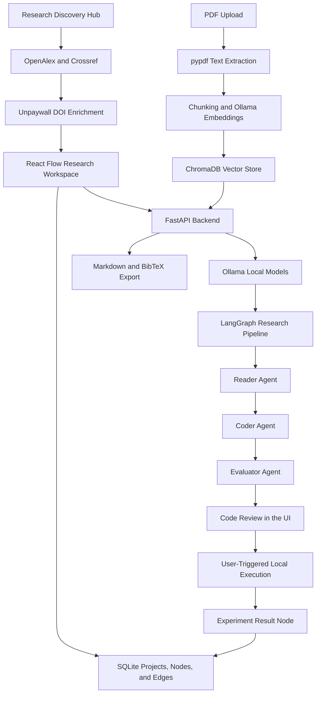

# ResearchGraph

**A visual research workspace for discovering academic literature, analysing papers, and connecting research artefacts.**

ResearchGraph brings scholarly discovery, PDF-based paper analysis, AI-assisted research workflows, and persistent visual project organisation into one application. Researchers can search academic metadata providers, add papers to a visual canvas, upload and index PDFs, inspect source excerpts, compare papers, explore research gaps, and prepare small benchmark experiments.

The project is built with Next.js, React Flow, FastAPI, LangGraph, Ollama, ChromaDB, and SQLite. It is designed to run locally on a standard development machine. A dedicated GPU is not required for the configured local models, although CPU inference speed depends on the host system.

---

## Contents

- [Core Capabilities](#core-capabilities)
- [Research Workflow](#research-workflow)
- [System Architecture](#system-architecture)
- [Technology Stack](#technology-stack)
- [Repository Structure](#repository-structure)
- [Prerequisites](#prerequisites)
- [Local Installation](#local-installation)
- [Environment Configuration](#environment-configuration)
- [Running the Application](#running-the-application)
- [Testing and Quality Checks](#testing-and-quality-checks)
- [Data Storage](#data-storage)
- [API Overview](#api-overview)
- [Security and Current Limitations](#security-and-current-limitations)
- [Troubleshooting](#troubleshooting)

---

## Core Capabilities

### 1. Academic Research Discovery

The Research Discovery Hub provides academic search and metadata enrichment within the workspace.

- **OpenAlex** is the primary scholarly search provider.
- **Crossref** supplies bibliographic metadata and DOI-based lookup.
- **Unpaywall** resolves open-access availability for individual DOI records.
- Search results are normalised and deduplicated using DOI and title matching.
- Available abstracts, authors, publication details, DOI values, and open-access links are displayed in the interface.
- A discovered paper can be added directly to the research canvas.

### 2. Visual Research Workspace

The application uses a React Flow canvas to organise research artefacts as connected nodes.

- Add discovered papers, uploaded PDFs, notes, synthesis results, research-gap results, and experiment outputs.
- Arrange and connect nodes on an interactive canvas.
- Create multiple independent research workspaces.
- Persist node positions, node data, relationships, and project information.
- Prevent duplicate discovered-paper nodes using DOI and provider identifiers where available.

### 3. PDF Ingestion and Semantic Retrieval

- Upload PDF research papers through the canvas.
- Extract text from PDF pages with `pypdf`.
- Process uploaded documents in a FastAPI background task.
- Split extracted text into overlapping chunks.
- Store vector embeddings in ChromaDB using Ollama's `nomic-embed-text` model.
- Retrieve content using paper-specific metadata filters to avoid mixing chunks from unrelated papers.

### 4. AI-Assisted Paper Analysis

ResearchGraph uses local Ollama models for paper-related assistance.

- Ask questions about an individual paper or relevant workspace content.
- Extract operational, architectural, or experimental parameters from paper context.
- Cross-reference connected papers and summarise similarities, differences, methods, and findings.
- Analyse connected papers for contradictions, methodological limitations, and potential research gaps.
- Inspect available PDF excerpts through the Citation Inspector, including page references when source text is available.

AI-generated analysis is intended to support research review. Users should verify important claims against the original papers.

### 5. Experiment Code Generation and Execution

The experiment workflow uses a LangGraph pipeline with three stages:

1. **Reader Agent:** extracts relevant parameters from the supplied paper context.
2. **Coder Agent:** generates a Python benchmark or simulation script using NumPy.
3. **Evaluator Agent:** checks the generated script using static pattern checks, Python compilation, and a preliminary local dry run.

The interface then presents the generated code for inspection and editing. A user can explicitly trigger execution, review the output and metrics, and save the result to the canvas.

### 6. Research Export

Each workspace can be exported in two formats:

- **Markdown research dossier (`.md`):** includes project information, connected papers, notes, synthesis results, research-gap analyses, and experiment records.
- **BibTeX bibliography (`.bib`):** generates citation entries from paper metadata stored in the workspace.

---

## Research Workflow

A typical workflow in ResearchGraph is:

1. Create or select a research workspace.
2. Search for literature in the Research Discovery Hub or upload PDF papers.
3. Add relevant sources to the canvas.
4. Index uploaded paper content for semantic retrieval.
5. Ask questions, inspect citations, cross-reference papers, or analyse research gaps.
6. Generate a small benchmark script from selected paper context.
7. Inspect and edit the generated code before explicitly running it.
8. Save useful outputs to the canvas and export the research dossier or bibliography.

---

## System Architecture



### Data and Processing Responsibilities

| Layer | Responsibility |
|---|---|
| Next.js frontend | Research canvas, discovery interface, workspace controls, analysis and experiment modals |
| React Flow | Visual node and edge interaction |
| FastAPI backend | API routes, paper processing, research operations, agent orchestration and exports |
| LangGraph | Reader, Coder and Evaluator workflow orchestration |
| Ollama | Local language model inference and text embeddings |
| ChromaDB | Semantic vector storage and paper-specific retrieval |
| SQLite | Workspace projects, graph nodes, graph edges and persistence |
| Academic APIs | Scholarly search, DOI metadata enrichment and open-access resolution |

---

## Technology Stack

| Area | Technologies |
|---|---|
| Frontend | Next.js 16, React 19, TypeScript, Tailwind CSS |
| Visualisation | React Flow (`@xyflow/react`) |
| Backend | Python, FastAPI, Uvicorn |
| Agent orchestration | LangGraph, LangChain, LangChain Ollama integration |
| Local language model | Ollama with `llama3.2:3b` |
| Embeddings | Ollama with `nomic-embed-text` |
| Vector storage | ChromaDB |
| Relational storage | SQLite |
| PDF extraction | pypdf |
| Academic discovery | OpenAlex, Crossref, Unpaywall |
| Testing | pytest, ESLint, Next.js production build |

---

## Repository Structure

```text
ResearchGraph/
├── backend/
│   ├── app/
│   │   ├── agents/
│   │   │   └── pipeline.py
│   │   ├── api/
│   │   │   ├── discovery.py
│   │   │   └── papers.py
│   │   ├── core/
│   │   │   └── config.py
│   │   ├── db/
│   │   │   ├── database.py
│   │   │   └── vector_store.py
│   │   ├── sandbox/
│   │   │   └── runner.py
│   │   ├── schemas/
│   │   │   └── discovery.py
│   │   ├── services/
│   │   │   ├── crossref.py
│   │   │   ├── discovery.py
│   │   │   ├── openalex.py
│   │   │   └── unpaywall.py
│   │   └── main.py
│   ├── tests/
│   │   ├── test_discovery.py
│   │   └── test_vector_indexing.py
│   ├── .env.example
│   └── requirements.txt
├── frontend/
│   ├── app/
│   │   ├── globals.css
│   │   ├── layout.tsx
│   │   └── page.tsx
│   ├── components/
│   │   ├── CitationInspectorModal.tsx
│   │   ├── CodeExperimentNode.tsx
│   │   ├── DiscoveryDrawer.tsx
│   │   ├── DiscoveryNode.tsx
│   │   ├── ExperimentModal.tsx
│   │   ├── ExportModal.tsx
│   │   ├── FormattedPlainText.tsx
│   │   ├── PaperNode.tsx
│   │   ├── ResizableNodeFrame.tsx
│   │   └── WorkspaceNodes.tsx
│   ├── package.json
│   └── package-lock.json
├── .gitignore
└── README.md
```

---

## Prerequisites

Install the following before setting up the project:

- **Python 3.11 or later** is recommended for the backend environment.
- **Node.js 20.9 or later** is required by the current Next.js version. Node.js 22 LTS is a suitable choice.
- **npm** is included with Node.js.
- **Git** for cloning the repository.
- **Ollama** for local model inference and embeddings.

Useful installation references:

- [Python downloads](https://www.python.org/downloads/)
- [Node.js downloads](https://nodejs.org/en/download/)
- [Git downloads](https://git-scm.com/downloads)
- [Ollama downloads](https://ollama.com/download)
- [Next.js installation requirements](https://nextjs.org/docs/app/getting-started/installation)
- [Ollama documentation](https://docs.ollama.com/)

A dedicated GPU is not mandatory. Model response time and embedding throughput will depend on the available CPU, memory, and storage.

---

## Local Installation

### 1. Clone the repository

```bash
git clone https://github.com/RJ42-CODER/ResearchGraph.git
cd ResearchGraph
```

### 2. Prepare Ollama

Install and start Ollama. Pull the models used by the current implementation:

```bash
ollama pull llama3.2:3b
ollama pull nomic-embed-text
```

Verify that both models are available:

```bash
ollama list
```

Ollama serves its local API at `http://localhost:11434` by default. The current embedding and agent integrations use this local endpoint.

### 3. Set up the backend

Open a terminal in the `backend` directory:

```bash
cd backend
```

Create a virtual environment:

```bash
python -m venv venv
```

Activate it on Windows PowerShell:

```powershell
.\venv\Scripts\Activate.ps1
```

Activate it on macOS or Linux:

```bash
source venv/bin/activate
```

Install the pinned backend dependencies:

```bash
python -m pip install --upgrade pip
python -m pip install -r requirements.txt
```

Create the local environment file from the supplied template.

Windows PowerShell:

```powershell
Copy-Item .env.example .env
```

macOS or Linux:

```bash
cp .env.example .env
```

Edit `backend/.env` and add the email address and optional API keys you intend to use. Do not commit this file.

### 4. Set up the frontend

Open a second terminal in the repository's `frontend` directory:

```bash
cd frontend
npm ci
```

The frontend uses `NEXT_PUBLIC_BACKEND_URL` when it is set. Otherwise, it defaults to `http://localhost:8000`.

For a non-default backend address, create `frontend/.env.local`:

```env
NEXT_PUBLIC_BACKEND_URL=http://localhost:8000
```

Do not place academic API keys or other secrets in frontend environment variables.

---

## Environment Configuration

The backend loads settings from `backend/.env` through `python-dotenv`. The configuration loader resolves this file independently of the terminal's current working directory.

### Academic API Settings

| Variable | Purpose | Requirement |
|---|---|---|
| `OPENALEX_API_URL` | OpenAlex API base URL | Defaults to `https://api.openalex.org` |
| `OPENALEX_API_KEY` | Optional OpenAlex API key | Optional. Keyless requests are supported |
| `CROSSREF_API_URL` | Crossref API base URL | Defaults to `https://api.crossref.org` |
| `CROSSREF_MAILTO` | Contact email for the Crossref polite pool | Recommended |
| `UNPAYWALL_API_URL` | Unpaywall API base URL | Defaults to `https://api.unpaywall.org` |
| `UNPAYWALL_EMAIL` | Contact email for Unpaywall DOI lookup | Required for Unpaywall enrichment |

### Other Runtime Settings

The backend also reads the following optional Ollama settings for direct chat, cross-reference, and research-gap requests:

| Variable | Purpose | Default |
|---|---|---|
| `OLLAMA_MODEL` | Ollama model used by the direct chat and analysis routes | `llama3.2:3b` |
| `OLLAMA_KEEP_ALIVE` | Model keep-alive duration | `1h` |
| `OLLAMA_NUM_THREADS` | CPU thread count passed to Ollama | `8` |

The LangGraph Reader and Coder pipeline currently configures `llama3.2:3b` directly in `backend/app/agents/pipeline.py`. Changing `OLLAMA_MODEL` does not currently change that pipeline model.

### Preserved Future Provider Settings

`backend/.env.example` also contains placeholders for DOAJ, CORE, and Hugging Face. These settings are retained for future development. They are not active integrations in the current application.

---

## Running the Application

Run the backend and frontend in separate terminals. Keep Ollama running in the background.

### Terminal 1: Backend

Start from the repository's `backend` directory with the virtual environment activated:

```bash
uvicorn app.main:app --reload --port 8000
```

The backend will be available at:

- API base: [http://localhost:8000](http://localhost:8000)
- Interactive API documentation: [http://localhost:8000/docs](http://localhost:8000/docs)

Start the backend from the `backend` directory so relative paths for uploads and ChromaDB resolve to `backend/data`.

### Terminal 2: Frontend

Start from the repository's `frontend` directory:

```bash
npm run dev
```

Open the application at:

[http://localhost:3000](http://localhost:3000)

### Production Build

To create and run a production frontend build:

```bash
npm run build
npm run start
```

The FastAPI backend must be started separately.

---

## Testing and Quality Checks

The backend test files are located in `backend/tests`. The project requirements file does not currently include pytest, so install it in the active virtual environment before running the tests:

```bash
python -m pip install pytest
```

Run the complete backend test suite from the `backend` directory:

```bash
python -m pytest tests
```

To run an individual test module:

```bash
python -m pytest tests/test_discovery.py
python -m pytest tests/test_vector_indexing.py
```

Run frontend linting and the production build from the `frontend` directory:

```bash
npm run lint
npm run build
```

These commands are provided for local verification. Test results depend on the installed environment and should be checked after each code change.

---

## Data Storage

The backend creates local data directories as needed. When started from the `backend` directory, the main data locations are:

| Path | Contents |
|---|---|
| `backend/data/research_graph.db` | SQLite project, node, and edge records |
| `backend/data/chroma_db/` | ChromaDB persistent vector collection |
| `backend/data/uploads/` | Uploaded PDF files |

These files are local application data and are excluded from version control by the repository's `.gitignore` rules. Back up the `backend/data` directory if you need to preserve local research workspaces across machine changes.

---

## API Overview

The following routes are implemented by the FastAPI backend.

| Method | Endpoint | Description |
|---|---|---|
| `GET` | `/api/discovery/search` | Search scholarly records using OpenAlex, Crossref, or both |
| `GET` | `/api/discovery/doi/{doi}` | Retrieve and enrich a paper record by DOI |
| `POST` | `/api/papers/upload` | Upload a PDF and begin background text extraction and indexing |
| `GET` | `/api/workspace/projects` | List research workspaces |
| `POST` | `/api/workspace/projects` | Create a research workspace |
| `DELETE` | `/api/workspace/projects/{project_id}` | Delete a workspace and its stored graph data |
| `GET` | `/api/workspace/graph` | Retrieve the nodes and edges for a workspace |
| `POST` | `/api/workspace/node` | Save a graph node |
| `DELETE` | `/api/workspace/node/{node_id}` | Delete a graph node and its connected edges |
| `POST` | `/api/workspace/edge` | Save a graph relationship |
| `DELETE` | `/api/workspace/reset` | Clear the nodes and edges in a workspace |
| `GET` | `/api/workspace/export` | Export a Markdown dossier or BibTeX bibliography |
| `GET` | `/api/papers/citation-excerpt` | Retrieve a page-based citation excerpt where available |
| `POST` | `/api/agents/chat` | Ask questions about paper or workspace context |
| `POST` | `/api/agents/cross-reference` | Compare connected papers |
| `POST` | `/api/agents/research-gap` | Analyse connected papers for potential research gaps |
| `POST` | `/api/agents/run-pipeline` | Run the Reader, Coder, and Evaluator workflow |
| `POST` | `/api/sandbox/execute` | Execute submitted code through the local subprocess runner |

The export route accepts `project_id`, `format` (`markdown` or `bibtex`), and `download` query parameters.

For request schemas and interactive testing, use the [FastAPI Swagger UI](http://localhost:8000/docs) after starting the backend.

---

## Security and Current Limitations

ResearchGraph is an actively developed prototype. The following limitations are important when running or evaluating the project.

### Local Code Execution Is Not a Secure Sandbox

The current runner in `backend/app/sandbox/runner.py` executes generated Python code through a local subprocess using the same operating-system user account as the backend. It applies a basic static pattern blocklist and a 15-second timeout.

These checks are not a security boundary. Static pattern checks can be bypassed, and a subprocess does not provide filesystem, network, or operating-system isolation. The Evaluator also performs a preliminary local dry run as part of pipeline validation. Do not use this feature to execute untrusted code.

Before exposing code execution to other users, replace the runner with a properly isolated environment such as a hardened container or dedicated execution service, with resource limits and network restrictions.

### Backend Network Exposure

The current FastAPI application has permissive CORS settings and does not implement user authentication. Run it on a trusted local machine or protected development network. The current PDF upload route also lacks a robust file-size limit. Do not expose the backend directly to the public internet without adding authentication, restrictive CORS rules, upload limits, rate limiting, and appropriate deployment controls.

### Academic API and Source Availability

- OpenAlex and Crossref records may contain incomplete metadata or abstracts.
- Unpaywall enrichment requires a configured email address and a valid DOI.
- Open-access status and full-text availability depend on the source record and its licence.
- ResearchGraph displays available external PDF links. It does not automatically download arbitrary remote PDFs.
- AI-generated summaries, comparisons, and research-gap suggestions must be checked against the source publications.

### Local Data and Credentials

- Keep API credentials in `backend/.env`.
- Do not add secret values to frontend variables, source files, screenshots, or public issue reports.
- Do not commit `.env`, uploaded papers, SQLite files, or ChromaDB data.
- Review the `.gitignore` before committing changes.

---

## Troubleshooting

### Ollama is not reachable

Confirm that Ollama is installed and running, then check the local model list:

```bash
ollama list
```

Verify that both required models are present:

```bash
ollama pull llama3.2:3b
ollama pull nomic-embed-text
```

The application expects Ollama at `http://localhost:11434` in the current implementation.

### Academic discovery returns few or no results

- Check the backend terminal for provider errors or rate-limit messages.
- Try a more specific or broader query.
- Configure `CROSSREF_MAILTO` and `UNPAYWALL_EMAIL` in `backend/.env`.
- Remember that Unpaywall is used for DOI-based open-access resolution, not keyword search.

### PDF upload succeeds but paper analysis has little context

- Confirm that the file is a text-based PDF and not only scanned page images.
- Wait for the backend background indexing task to finish.
- Check the backend terminal for PDF extraction or ChromaDB errors.
- Confirm that Ollama is running and the `nomic-embed-text` model is available.

### Frontend cannot reach the backend

- Confirm that FastAPI is running on port `8000`.
- Confirm that `NEXT_PUBLIC_BACKEND_URL` points to the backend address if you changed the default.
- Restart the Next.js development server after changing `frontend/.env.local`.

### Dependency installation fails

- Confirm that the active terminal is using the intended Python virtual environment.
- Upgrade pip before installing the pinned dependencies.
- On Windows, check that the selected Python version has compatible wheels for the pinned packages.
- Keep frontend dependencies installed with `npm ci` so the versions from `package-lock.json` are used.

---
